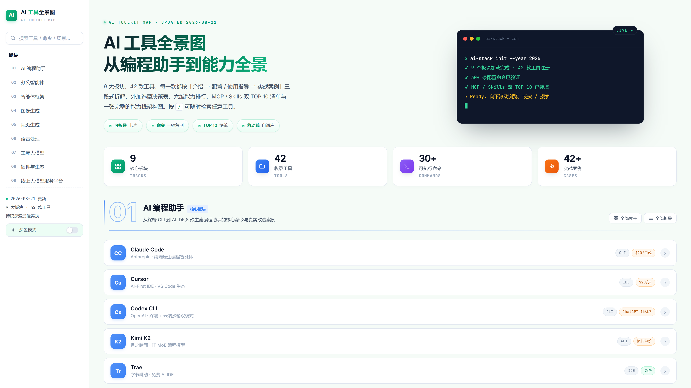

# AI 工具全景图 · AI TOOLKIT MAP

> **9 大板块 · 42 款 AI 工具** —— 一张从编程助手到能力栈架构的交互式全景地图。

**这是一个纯 HTML 单文件项目**：所有页面结构、样式、交互脚本全部内嵌在 `index.html` 一个文件里，仅外挂一份 `aihot_data.json` 作为数据源。无框架、无构建、无后端、无 npm 依赖（仅引用 Google Fonts）。



---

## 快速开始

无需安装任何依赖，起一个本地静态服务器即可：

```bash
python -m http.server 8080
# 打开 http://localhost:8080
```

> ⚠️ 不要直接双击 `index.html`：页面用 `fetch` 加载 `aihot_data.json`，浏览器会拦截 `file://` 下的 `fetch`，导致数据加载失败、页面空白。

---

## 功能一览

- 🗂 **9 大板块导航**，42 款工具按「介绍 → 配置指导 → 实战案例」三段式展开 / 折叠。
- 🔍 **实时搜索**（`/` 聚焦），过滤工具卡片并自动展开命中项。
- 🖥 **命令一键复制**，代码块与 MCP / Skills 命令点击即复制。
- 📊 **数据可视化**：数字滚动统计、六维能力排行、MCP / Skills 双 TOP 10、能力栈架构图（L0 → L4）。
- 🌗 **深色模式** + 📱 **移动端自适应**（汉堡菜单、抽屉侧边栏、返回顶部）。

---

## 项目结构

```
ai-toolkit-map/
├── index.html         # 单文件主体（结构 + 样式 + 脚本）
├── aihot_data.json    # 全部工具数据
└── imgs/              # README 插图
```

---

## 数据维护

所有展示数据集中于 `aihot_data.json`，由 `index.html` 启动时 `fetch` 加载。新增 / 修改工具只需编辑该 JSON：

- 在对应板块 `sections[i].tools` 中追加对象，字段：`name`、`sub`、`chips`、`intro`、`config`、`case`。
- 可选：`table`（对比表）、`decide`（决策）、`verdict`（结论）、`rank`（排行）、`top10`（榜单）、`arch`（架构图）。
- 首页统计（板块 / 工具 / 命令 / 案例数）由 `index.html` 自动计算，无需手动维护。

---

## 说明

- 价格为 **2026-08 参考值**，实际以官方为准；内容基于公开资料整理，仅供学习与选型参考。
- 项目为纯前端演示页，无后端与数据采集逻辑。

## 开源协议

基于 **MIT License** 开源，详见 [LICENSE](LICENSE)。
